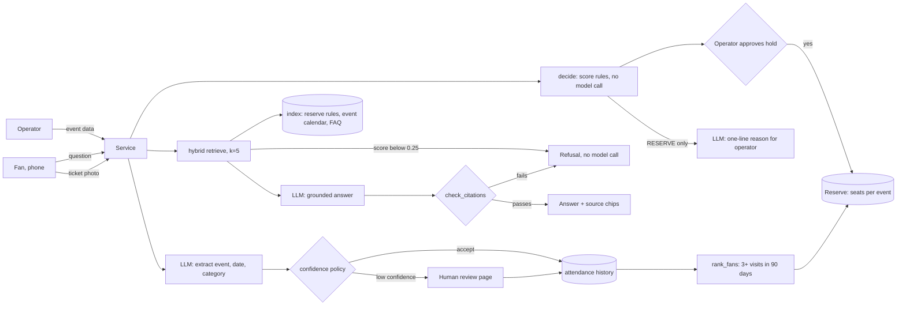

# Design Review · FanReserve · [team name]

Members: [Torrnike Varshalomidze · Tornike111 · backend] · [Murman Gorgadze · Murman-Gorgadze · backend] · Repo: [https://github.com/Murman-Gorgadze/Building-AI-powered-application/tree/main] · `design-review`

## 1 · Problem, users, success criteria

**Problem.** Fans who go to the same kind of event every week (football, concerts) lose out when a big event sells out: they refresh a ticket site and find nothing. Organisers can hold a reserve of tickets for these fans, but every held seat is unsold revenue if the event would have sold anyway. Today the choice of which events get a reserve is made by gut feeling, so organisers either hold too much (waste) or too little (loyal fans shut out). Spec: `docs/spec.md`.

**Users.** (1) *Loyal fans*, at least 3 visits to one event category in 90 days, who want first access to a related big event. (2) *The operator* (ticketing manager), who decides each day which events get a reserve and how many seats.

| # | Success criterion | Measured by | Today |
|---|---|---|---|
| S1 | RESERVE decisions are right (event sold out or at least 95% full) at least 75% of the time | backtest script over at least 50 past events | not run yet; 3 rule tests pass (`hw1/Murman-Gorgadze/tests/`) |
| S2 | A fan answer cites a retrieved source, or the service refuses | `evals/golden.yaml`, `tests/test_answer.py` | [x/5, see section 4] |
| S3 | A ticket photo counts as attendance only when event, date and category are all accepted; otherwise it goes to confirm or review | Lab 3 `tests/`, `docs/confidence-policy.md` | [passing / not yet] |
| S4 | Median cost per request under $0.005, p95 latency under 4 s | `logs/usage.jsonl` | see section 5 |

## 2 · Architecture and data flow

| Model call | Model id | Input | Output | Validated by |
|---|---|---|---|---|
| embed | [id from `.env`] | corpus chunks at ingest, the question at query time | vectors | index refuses a mismatched model |
| grounded answer | [id from `logs/usage.jsonl`] | question + 5 numbered sources | `{answer, citations, grounded}` | schema check, then `check_citations()` |
| ticket extraction | [id] | downscaled photo + schema | value, evidence, confidence per field | schema check, then confidence policy |
| operator reason | [id] | the `reasons` list from `decide()` | one sentence | may only restate the listed reasons |

**Not obvious.** `decide()` makes no model call: the score is a weighted sum (tier, weekday, holiday, tour, sell-through speed) in `src/reserve.py`, so the money decision is cheap, repeatable and explainable (`docs/decisions/0001`). The model only writes the explanation (`docs/decisions/0002`). The refusal arrow after retrieval means nothing is generated when nothing relevant was found. Humans sit in two places: the operator approves every hold, and low-confidence ticket photos go to a review page.

## 3 · Risks and safety threats

| Risk | What a user would see | Mitigation (link, or plan and week) | Owner |
|---|---|---|---|
| Wrong reserve call: seats held for an event that sells anyway, or none held for one that sells out | wasted inventory, or loyal fans shut out | WATCH state between RESERVE and SKIP; reasons shown per decision; reserve share capped (constants in `src/reserve.py`); operator approves every hold; backtest to tune the 60/40 thresholds, plan: Week 7 | [spec keeper] |
| Fake loyal fans or scalpers farming attendance | one account buying many reserve tickets | attendance counts only from accepted ticket proof (`docs/confidence-policy.md`); per-fan purchase cap, plan: Week 8 | [repo keeper] |
| Invented rule or price in a fan answer | "reserve tickets cost X" with no source | grounded answers with `check_citations()`; refusal path below 0.25 retrieval score; golden question on the fee | [eval keeper] |
| Wrong holiday or event data | holiday eve not recognised, wrong weekday weight | holiday list is config, marked as a sample in `src/reserve.py`; verify against the official calendar, plan: Week 6 | [spec keeper] |
| Ticket photos hold names, barcodes, QR codes | personal data stored or leaked | store only the extracted fields, delete the image after extraction, plan: Week 6; no real tickets in `tests/images/` | [repo keeper] |
| Text inside a photo or document says "ignore your rules" | the model obeys the attacker | retrieved and extracted text is data, never instructions; red-team test planned for Week 12 | [spec keeper] |
| Provider outage or price change | answers fail or cost doubles | `usage.jsonl` shows cost per call; reserve decisions need no model, so the core keeps working; fallback model chain, plan: Week 10 | [repo keeper] |

## 4 · Evaluation plan

- Golden set: [`evals/golden.yaml`](../evals/golden.yaml), 5 questions (2 factual, 1 reasoning, 1 edge, 1 refusal), threshold 0.70.
- Last live run: [date] · [`evals/results/<file>.json`] · **[x/5, pass rate]**.
- What failed and why: [one line per failure with the diagnosis. Example: "g3 retrieved the wrong chunk because the rule uses the word 'reserve' and the question says 'saved seats'; we will add the synonym to the policy page and log it as a decision."]
- Rule tests: 3 of 3 golden cases pass for `decide()` and `rank_fans()` (`hw1/Murman-Gorgadze/golden.md`). The thresholds are untuned guesses until S1's backtest runs.
- By Week 11: 10 questions (add 1 factual, 1 reasoning, 1 edge, 1 refusal, 1 format), a judge from a different model family for answers `must_mention` cannot check, and the run in CI. The 0.70 gate will block a merge that drops grounding or stops refusing questions it cannot answer.

## 5 · Token budget

Medians must come from `logs/usage.jsonl`. Rows marked *estimate* use my assumed prices ($0.30 per million tokens in, $2.50 out; check OpenRouter) and are replaced by log medians before submission.

| Feature | Model | Tokens in / out (median) | Cost per request | Latency (median) | Source |
|---|---|---|---|---|---|
| fan question | [id] | about 1,650 / 150 | about $0.0009 | [s] | estimate; replace from log |
| ticket extraction | [id] | about 1,400 / 200 | about $0.0009 | [s] | estimate; replace from log |
| operator reason | [id] | about 600 / 150 | about $0.0006 | [s] | estimate; replace from log |
| `decide()` | none | 0 / 0 | $0 | milliseconds | local code |

**Monthly** at 500 fans × 2 questions a day, 100 ticket photos a day, 50 operator reasons a day: 30,000 × $0.0009 + 3,000 × $0.0009 + 1,500 × $0.0006 ≈ **$30 a month**.

**RAG or long context.** Putting a [30,000-token] corpus in every prompt would cost about $0.0094 per question against $0.0009 with five chunks, roughly 11 times more, and slower. We use retrieval. Replace the corpus size with the real count.

