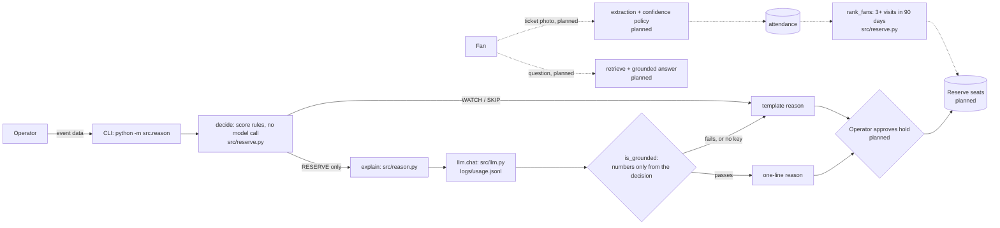

# Design Review · FanReserve · MG-TV

Members: Murman Gorgadze · Murman-Gorgadze · repo keeper, spec keeper · Tornike Varshalomidze · Tornike111 · eval keeper · Repo: https://github.com/Murman-Gorgadze/Building-AI-powered-application · tag `design-review`

*Revised on 18 November 2026 after the Milestone 1 feedback. Every line either points at a file in this repo or is marked **planned** with a week. The version graded at the deadline is commit 988cf31.*

## 1 · Problem, users, success criteria

**Problem.** Fans who go to the same kind of event every week (football, concerts) lose out when a big event sells out. Organisers can hold a reserve of tickets for these fans, but every held seat is unsold revenue if the event would have sold anyway. Today the choice of which events get a reserve is made by gut feeling, so organisers either hold too much (waste) or too little (loyal fans shut out). Spec: [`docs/spec.md`](spec.md).

**Users.** (1) *Loyal fans*, at least 3 visits to one event category in 90 days, who want first access to a related big event. (2) *The operator* (ticketing manager), who decides each day which events get a reserve and how many seats.

| # | Success criterion | Measured by | Today |
|---|---|---|---|
| S1 | RESERVE decisions are right (sold out or ≥ 95% full) at least 75% of the time | backtest over ≥ 50 past events | **planned**, Week 11: no past-event data yet. 29 unit tests pass (`tests/`) |
| S2 | Every operator reason restates only `decide()`'s facts, or the template is used | `tests/test_reason.py` | met in tests: 7 of 7 pass |
| S3 | Median cost per model call under $0.005, p95 latency under 4 s | `logs/usage.jsonl` | **planned**: needs the first live calls |
| S4 | `decide()` answers in under 200 ms with no model call | `tests/test_reserve.py` | met |
| S5 | A fan answer cites a retrieved source, or the service refuses | `evals/golden.yaml` | **planned**, after HW2 |
| S6 | A ticket photo counts as attendance only when event, date and category are all accepted | ticket-extraction tests | **planned** |

## 2 · Architecture and data flow

Solid boxes exist in `src/` today. Boxes marked *(planned)* do not exist yet.

| Model call | Model id | Input | Output | Validated by | Status |
|---|---|---|---|---|---|
| operator reason | `google/gemini-3.8-flash` (`FANRESERVE_MODEL`, `.env.example`) | `facts()`: action, score, seats, reasons | one sentence | `is_grounded()` in `src/reason.py`, else template | **built**, `tests/test_reason.py` |
| grounded fan answer | not chosen | question + retrieved sources | answer + citations | schema check + citation check | **planned** |
| ticket extraction | not chosen | downscaled photo + schema | value, evidence, confidence per field | schema check + confidence policy | **planned** |
| embeddings | not chosen | corpus chunks, question | vectors | index refuses a mismatched model | **planned** |

**Not obvious.** `decide()` makes no model call: the score is a weighted sum in `src/reserve.py`, so the money decision is free, repeatable and explainable ([decision 0001](decisions/0001-rules-not-a-model-for-decide.md)). The model only writes the explanation, and a sentence with any number the decision did not produce is thrown away ([decision 0002](decisions/0002-model-writes-only-the-reason.md)). Every model call goes through `src/llm.py` and is logged ([decision 0003](decisions/0003-openrouter-through-llm-py.md)). With no key, or when the provider is down, the operator still gets the template reason.

## 3 · Risks and safety threats

| Risk | What a user would see | Mitigation (link, or plan and week) | Owner |
|---|---|---|---|
| Wrong reserve call | wasted inventory, or loyal fans shut out | exists: WATCH band and reasons per decision (`src/reserve.py`, `tests/test_reserve.py`). Planned: operator approval of every hold, Lab 7 agent slice; backtest to tune 60/40, Week 11 | Murman-Gorgadze |
| Model invents a cause or number in the operator reason | operator approves a hold for a reason the score never used | exists: `is_grounded()` + template fallback (`tests/test_reason.py::test_invented_number_falls_back_to_template`). Gap: causes without numbers are not caught; golden cases for that in HW2 week | Tornike111 |
| Invented rule or fee in a fan answer | "reserve tickets cost X" with no source | planned with the fan Q&A slice: citation check and refusal when retrieval finds nothing; a golden question on the fee, after HW2 | Tornike111 |
| Fake loyal fans or scalpers farming attendance | one account buying many reserve tickets | planned: attendance only from accepted ticket proof (ticket-photo slice); per-fan purchase cap, Week 12 | Murman-Gorgadze |
| Wrong holiday data | holiday eve not recognised | exists: Georgian 2026 list in `src/reserve.py`, tested in `tests/test_reserve.py`. Still to do: check against matsne.gov.ge, Week 10 | Murman-Gorgadze |
| Ticket photos hold names, barcodes, QR codes | personal data stored or leaked | planned with the ticket-photo slice: keep only extracted fields, delete the image; no real tickets in the repo | Tornike111 |
| Text in a photo or document says "ignore your rules" | the model obeys the attacker | exists for the reason: the prompt marks facts as data, and only `decide()`'s own strings reach it. Red-team test planned for Week 12 | Tornike111 |
| Provider outage or price change | reasons fail or cost doubles | exists: `decide()` needs no model; failed calls are logged with `ok: false` and fall back to the template (`tests/test_llm.py`). Planned: fallback model chain, Week 10 | Murman-Gorgadze |

## 4 · Evaluation plan

- Rule tests: 29 of 29 pass for `decide()`, `rank_fans()`, `llm.py` and `reason.py` (`pytest`, no key). HW1 golden questions: 3 of 3 pass, with real outputs in [`hw1/Murman-Gorgadze/golden.md`](../hw1/Murman-Gorgadze/golden.md). Mutation runs there show the tests fail when the feature breaks.
- Golden set for model features: **planned** for HW2 week. `evals/golden.yaml` with 5 cases for the `decide()` tool (one adversarial, `sold_pct` = 150) and one committed result file in `evals/results/`, even if it fails.
- By Week 11: 10 questions including the fan Q&A (factual, reasoning, edge, refusal, format), a judge from a different model family for what string checks cannot catch, and the run in CI with a 0.70 gate.

## 5 · Token budget

Measured rows come from `logs/usage.jsonl`. Prices are OpenRouter's, read on 18 November 2026: $0.825 per million tokens in, $4.125 out, for `google/gemini-3.8-flash`. The first draft used $0.30 / $2.50, which is another model's price.

**First live calls, 20 November 2026.** We had no paid credit, so the calls went to OpenRouter's free models through the same `src/llm.py` path (`FANRESERVE_MODEL=...:free`). Seven calls are in `logs/usage.jsonl`: six were refused by the provider with HTTP 429 (free model busy) and fell back to the template, as designed; one succeeded on `nvidia/nemotron-3.5-lightning:free` with **158 tokens in, 120 out, 1,642 ms**. The output hit the `max_tokens=120` cap and `is_grounded()` rejected it, so the operator saw the template sentence. The cost below applies the Gemini price to the measured token counts. One successful call is a sample, not a median: we will replace it once there are at least ten.

| Feature | Model | Tokens in / out (median) | Cost per request | Latency (median) | Source |
|---|---|---|---|---|---|
| operator reason | `google/gemini-3.8-flash` (measured on `nvidia/nemotron-3.5-lightning:free`) | 158 / 120 (1 call) | $0.0006 at the Gemini price ($0 on the free model) | 1,642 ms (1 call) | `logs/usage.jsonl`, 2026-11-20 |
| `decide()` | none | 0 / 0 | $0 | under 1 ms | `tests/test_reserve.py` |
| fan question | not chosen | about 1,650 / 150 | about $0.0020 | n/a | estimate, **planned** slice |
| ticket extraction | not chosen | about 1,400 / 200 | about $0.0020 | n/a | estimate, **planned** slice |

**Monthly** at 500 fans × 2 questions a day, 100 ticket photos a day and 50 operator reasons a day: 30,000 × $0.0020 + 3,000 × $0.0020 + 1,500 × $0.0006 ≈ **$67 a month**, almost all of it from the planned fan Q&A. Today's built feature alone costs about $0.94 a month (measured tokens), up from the $0.60 estimate: the output used all 120 allowed tokens instead of the 40 we expected.

**RAG or long context.** Planned slice. A 30,000-token corpus (an estimate: no corpus exists yet) in every prompt would cost about $0.025 per question against about $0.002 with five retrieved chunks, roughly 13 times more, and slower. We will use retrieval and replace the corpus size with the real count.

## 6 · Team, roles and decisions

- Team contract: [`TEAM-CONTRACT.md`](../TEAM-CONTRACT.md), signed by a commit from each member's account. Roles: [`docs/TEAM-REPO.md`](TEAM-REPO.md) section 1.
- Decision records: [0001 rules, not a model, for `decide()`](decisions/0001-rules-not-a-model-for-decide.md) · [0002 the model writes only the reason](decisions/0002-model-writes-only-the-reason.md) · [0003 every call through `llm.py`](decisions/0003-openrouter-through-llm-py.md)
- Workflow: one person opens a pull request, the other reviews and merges. Nothing goes straight to `main`.
- What we build next, and who drives it: HW2 tool contract for `decide()` (each member drives their own HW2; Murman drives the shared MCP server, Tornike reviews). Then the fan Q&A slice, driven by Tornike as eval keeper.
